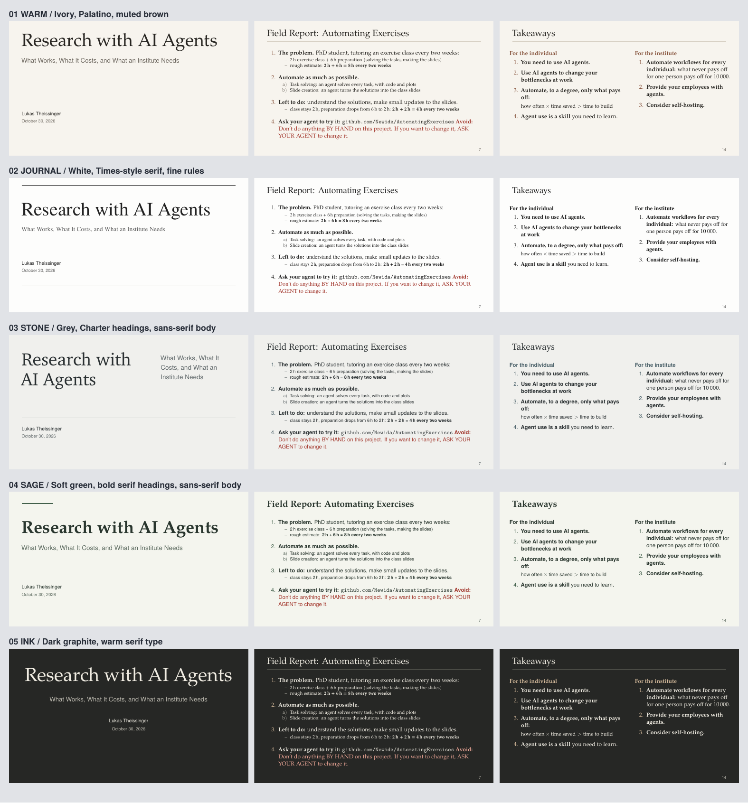

# Paper, with less decoration

Five studies based on the original **05 Paper**. The warm, typographic direction
stays; the circles, giant Roman numerals, small caps and repeated running titles
go. These differ in typography, cover composition and treatment of content blocks,
not just colour. No gradients, fake terminal UI or decorative graphics.



| # | Design | Treatment | Full deck | Every slide |
|---|---|---|---|---|
| **1** | **Warm** | Closest to Paper: ivory, Palatino throughout, quiet brown accents; a simple left-aligned cover. | [PDF](paper-warm.pdf) | [Preview](sheet-paper-warm.png) |
| **2** | **Journal** | Almost-white, Times-style serif, black ink. Fine rules replace filled cards. | [PDF](paper-journal.pdf) | [Preview](sheet-paper-journal.png) |
| **3** | **Stone** | Light grey, Charter headings and sans-serif body. Asymmetrical cover and white data panels. | [PDF](paper-stone.pdf) | [Preview](sheet-paper-stone.png) |
| **4** | **Sage** | Soft green, bold serif headings and sans-serif body. A short cover rule and lightly marked blocks. | [PDF](paper-sage.pdf) | [Preview](sheet-paper-sage.png) |
| **5** | **Ink** | Dark graphite with warm, paper-coloured serif text. Centred cover, subtle rules; no neon or glow. | [PDF](paper-ink.pdf) | [Preview](sheet-paper-ink.png) |

[Download the comparison PDF](paper-compare.pdf) · [Original five designs](README.md)

All five contain the same 14 slides / 51 pages, including click-by-click reveals.
Wording, speaker notes, formulas, charts and TODOs are unchanged. The original
`main.pdf` and the first five design PDFs are not replaced.

## Rebuild

From the repository root, with the existing pdfLaTeX and Poppler installation:

```sh
./make-variants.sh --paper                    # all five Paper studies
./make-variants.sh paper-warm paper-journal   # selected studies
./make-variants.sh                           # original five designs
```

The themes share `themes/paper-base.tex`. Installed TeX Gyre / Charter fonts are
used; no font downloads or additional dependencies are required. Builds preserve
the source wording and overlays, check for overflow, then produce complete PDFs,
per-design previews and a separate Paper comparison so the original comparison
is retained. Logs and intermediate files stay in `variants/.build/`.
