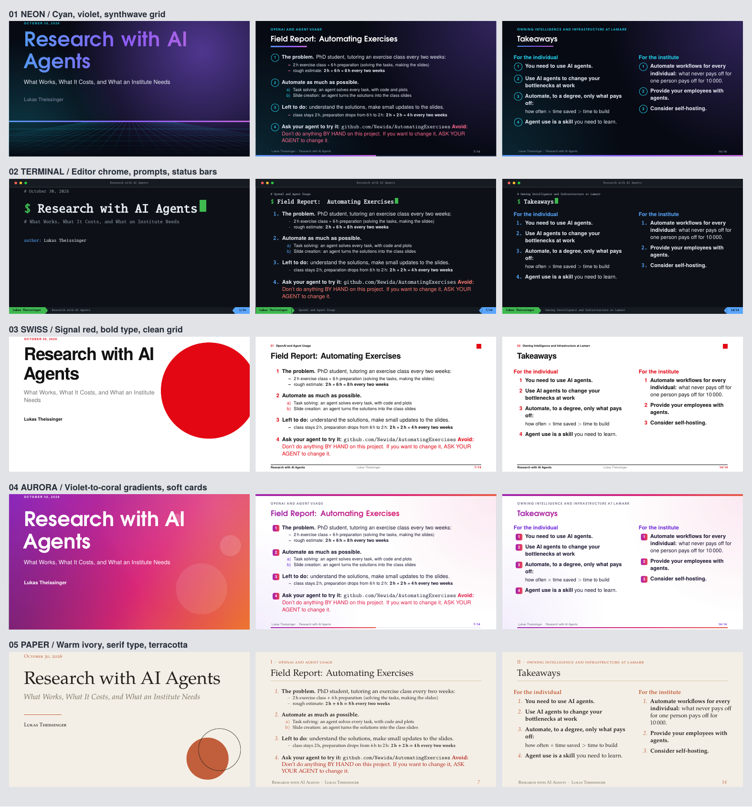

# Five visual designs

The same talk, wording, speaker notes and click-by-click reveals in five styles.
The original `main.pdf` is not replaced. The transition-to-David TODO is still a
LaTeX comment at the end of `main.tex`.



| Design | Look | Full deck | All slides at a glance |
|---|---|---|---|
| **01 Neon** | Near-black, cyan-to-violet type, synthwave grid | [neon.pdf](neon.pdf) | [Preview](sheet-neon.png) |
| **02 Terminal** | Dark editor window, monospace prompts, status bars | [terminal.pdf](terminal.pdf) | [Preview](sheet-terminal.png) |
| **03 Swiss** | White, black and signal red; bold type and a strict grid | [swiss.pdf](swiss.pdf) | [Preview](sheet-swiss.png) |
| **04 Aurora** | Violet-to-coral gradients, light content pages, soft cards | [aurora.pdf](aurora.pdf) | [Preview](sheet-aurora.png) |
| **05 Paper** | Warm ivory, editorial serif type, terracotta accents | [paper.pdf](paper.pdf) | [Preview](sheet-paper.png) |

[Download the comparison as a PDF](compare.pdf). Each complete deck has the same
14 logical slides and 51 PDF pages including overlays.

## Rebuild

From the repository root, using the existing pdfLaTeX/Poppler installation:

```sh
./make-variants.sh                # all five decks + visual comparisons
./make-variants.sh neon swiss     # just these two
pdflatex main.tex                 # the unchanged default appearance
```

No font downloads or new Python dependencies are needed. Themes use the installed
TeX Gyre / Latin Modern fonts; preview generation uses Python's standard library,
pdfLaTeX and `pdftoppm`.

`main.tex` is the only content source. The build selects `themes/<name>.tex` and
adds Beamer's `shrink=0` fit option to **generated** frames so dense content stays
inside each design's headers and footers. It checks for compilation errors and
layout overflow before publishing PDFs. Intermediates and logs stay in
`variants/.build/` and are not tracked in Git.
